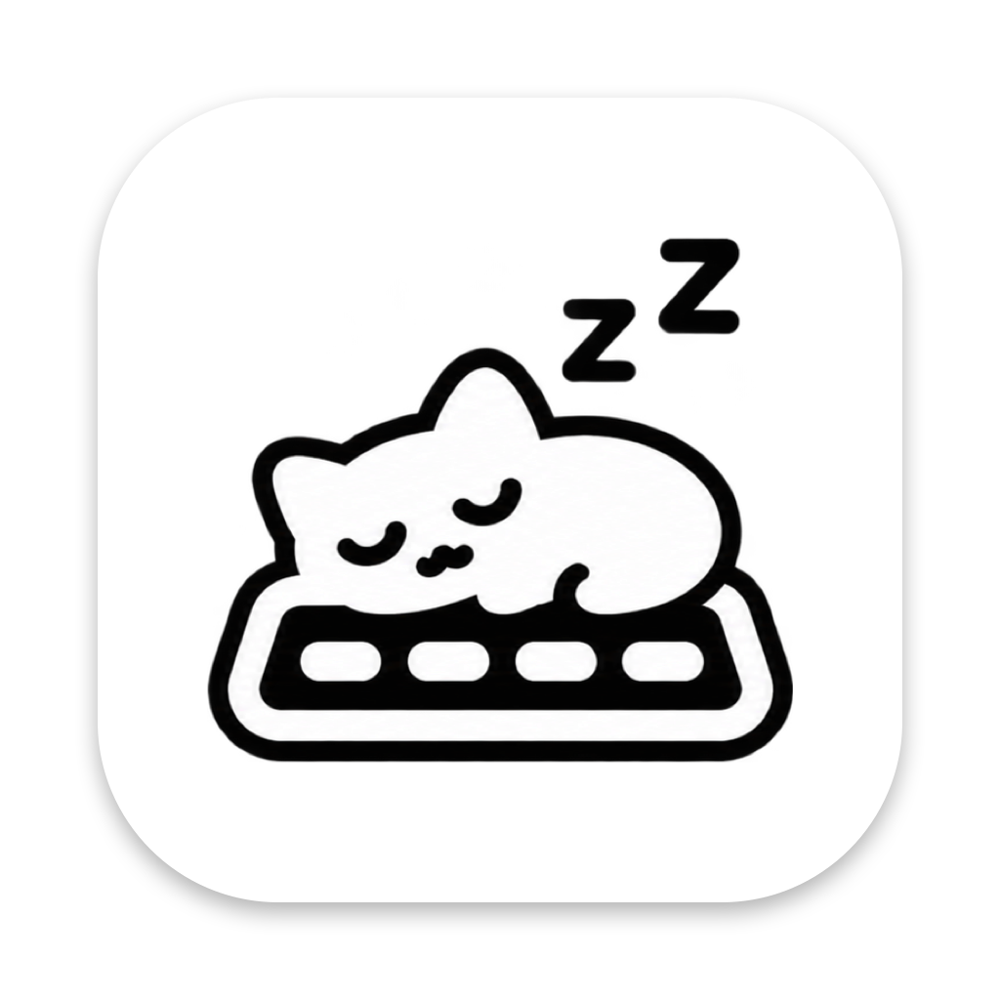

<p align="center">
  
</p>

<h1 align="center">yathing</h1>

<p align="center">
  윈도우 키보드를 맥에서 그대로.<br>
  Ctrl+C로 복사하고, Alt+Tab으로 앱을 바꾸고, 한/영 키로 한영 전환.
</p>

<p align="center">
  <a href="https://github.com/sasca37/yathing/releases/latest"></a>
  
  
  <a href="LICENSE"></a>
</p>

---

## 이런 분께 맞아요

- 윈도우를 쓰다가 맥으로 넘어왔는데 **Ctrl+C가 안 돼서** 답답한 분
- 맥에 **윈도우 키보드**를 연결했더니 Alt와 Win 키 자리가 뒤바뀌어 헷갈리는 분
- **한/영 키**나 **우측 ⌘** 한 번으로 한영 전환하고 싶은 분

설정 파일을 만질 필요 없이, 메뉴바에서 한 번 고르면 끝입니다.

## 키보드 모드

메뉴바의 yathing 아이콘에서 셋 중 하나를 고르세요. 언제든 바로 바꿀 수 있습니다.

| 모드 | 이렇게 바뀌어요 | 추천 |
|---|---|---|
| **맥 키보드** | 아무것도 바꾸지 않아요 | 맥 키보드를 쓸 때 |
| **윈도우 키보드 · 맥처럼** | Alt 자리가 ⌘, Win 자리가 ⌥가 돼요. 맥 키보드와 같은 배열이에요 | 맥 단축키에 익숙해지고 싶을 때 |
| **윈도우 키보드 · 윈도우처럼** | 윈도우 단축키를 그대로 써요 | 윈도우에서 막 넘어왔을 때 |

### "윈도우처럼" 모드에서 쓸 수 있는 단축키

| 누르는 키 | 하는 일 |
|---|---|
| Ctrl+C / V / X | 복사 / 붙여넣기 / 잘라내기 |
| Ctrl+Z / A / S / F | 되돌리기 / 전체 선택 / 저장 / 찾기 |
| Alt+Tab | 앱 전환 (Shift를 같이 누르면 반대로) |
| Ctrl+Tab | 브라우저 다음 탭 (Shift: 이전 탭) |
| Home / End | 줄 맨 앞 / 맨 뒤로 |
| Ctrl+Home / End | 문서 맨 앞 / 맨 뒤로 |
| Ctrl+← / → | 단어 단위로 이동 |
| Ctrl+Backspace / Delete | 단어 단위로 지우기 |
| Alt+F4 | 창 닫기 |
| Print Screen | 화면 캡처 (영역 선택) |
| Ctrl+Shift+Esc | 앱 강제 종료 창 |
| Win+E / D / L | Finder 열기 / 바탕화면 보기 / 화면 잠금 |
| Win+← / → / ↑ | 창을 왼쪽 절반 / 오른쪽 절반 / 최대화 |
| 한/영 | 한영 전환 |

Shift를 같이 누르면 선택하면서 이동합니다 (예: Shift+Home → 줄 맨 앞까지 선택).

## 그 밖의 기능

- **한영 전환 키 바꾸기** — 우측 ⌘(또는 원하는 키)로 한영 전환
- **창 분할 단축키** — ⌃⌥+방향키로 창을 왼쪽·오른쪽·위·아래 절반으로, ⌃⌥+Return으로 최대화. 단축키는 바꿀 수 있어요
- **키 이벤트 보기** — 키를 누르면 어떤 키로 인식되는지 바로 보여 줘요. 키보드 문제를 찾을 때 유용해요
- **로그인 시 자동 실행**

## 설치

**Homebrew**

```
brew install --cask sasca37/tap/yathing
```

**직접 설치**

1. [최신 버전](https://github.com/sasca37/yathing/releases/latest)에서 `yathing-<버전>.dmg`를 받습니다.
2. DMG를 열고 **yathing**을 **Applications** 폴더로 끌어다 놓습니다.
3. 응용 프로그램에서 yathing을 실행합니다. 메뉴바에 고양이 아이콘이 생깁니다.

macOS 13 이상, Apple Silicon과 Intel Mac 모두 지원합니다. Apple의 공증을 받은 앱이라 바로 열립니다.

## 처음 설정: 권한 허용

키보드 입력을 바꾸려면 macOS 권한 두 가지가 필요합니다.
**시스템 설정 → 개인정보 보호 및 보안**에서 yathing을 켜 주세요.

| 권한 | 필요한 이유 |
|---|---|
| **손쉬운 사용** | 키 입력을 바꾸고, 창 분할로 다른 앱의 창을 옮기기 위해 |
| **입력 모니터링** | 어떤 키를 눌렀는지 알기 위해 |

두 가지를 모두 켠 뒤 yathing을 **종료하고 다시 실행**하세요.
메뉴바 아이콘 → **설정…**에서 권한과 "키 처리 엔진" 상태가 모두 정상인지 확인할 수 있습니다.

> **개인정보**: 키 입력은 이 Mac 안에서만 처리합니다. 디스크에 저장하거나 네트워크로 보내지 않습니다.
> 소스 코드는 이 저장소에 모두 공개되어 있습니다.

## 자주 묻는 질문

<details>
<summary><b>권한을 켰는데 설정 창에 계속 "필요"라고 나와요</b></summary>

시스템 설정의 권한 목록에서 yathing을 선택해 **−** 로 지운 뒤, yathing을 다시 실행해 권한을 다시 허용하세요.
업데이트 전 버전으로 등록된 항목이 남아 있으면 이런 일이 생깁니다.
</details>

<details>
<summary><b>우측 ⌘로 한영 전환이 안 돼요</b></summary>

yathing은 기본으로 우측 ⌘를 F15 키로 바꿉니다. macOS에 "F15를 누르면 한영 전환"을 한 번 알려 줘야 합니다.

**시스템 설정 → 키보드 → 키보드 단축키 → 입력 소스 → 이전 입력 소스 선택**을 누르고 우측 ⌘를 누르면 F15가 입력됩니다.

그래도 안 되면 yathing 설정 창의 키 매핑에서 대상을 **입력 소스 전환**으로 바꾸세요. yathing이 직접 전환합니다.
</details>

<details>
<summary><b>맥북 내장 키보드도 같이 바뀌어요</b></summary>

키보드 모드는 연결된 모든 키보드에 적용됩니다. 내장 키보드를 쓸 때는 메뉴바에서 **맥 키보드**로 바꾸세요.
</details>

<details>
<summary><b>"윈도우처럼" 모드에서 터미널의 Ctrl+C가 복사가 돼요</b></summary>

이 모드는 Ctrl을 ⌘로 바꾸기 때문에 Ctrl+C가 "복사"가 됩니다. 터미널에서 실행을 멈추려면 Win+C를 누르세요 (Win 키가 맥의 Control 역할을 합니다).
같은 이유로 Ctrl+클릭은 ⌘클릭이 됩니다. 우클릭은 마우스 오른쪽 버튼을 쓰세요.
</details>

<details>
<summary><b>Win+D(바탕화면 보기)가 안 돼요</b></summary>

yathing은 macOS 기본 "바탕화면 보기" 단축키(F11)를 보냅니다. 시스템 설정에서 이 단축키를 바꿨다면 F11로 되돌려 주세요.
</details>

<details>
<summary><b>앱을 지우면 키보드가 원래대로 돌아오나요?</b></summary>

네. yathing을 종료하면 바꾼 키가 모두 원래대로 돌아옵니다. 혹시 남아 있다면 Mac을 재시동하세요.
</details>

## 직접 빌드하기

빌드, 배포, 코드 구조는 [개발 문서](docs/DEVELOPMENT.md)를 보세요.

## 라이선스

[MIT](LICENSE)
